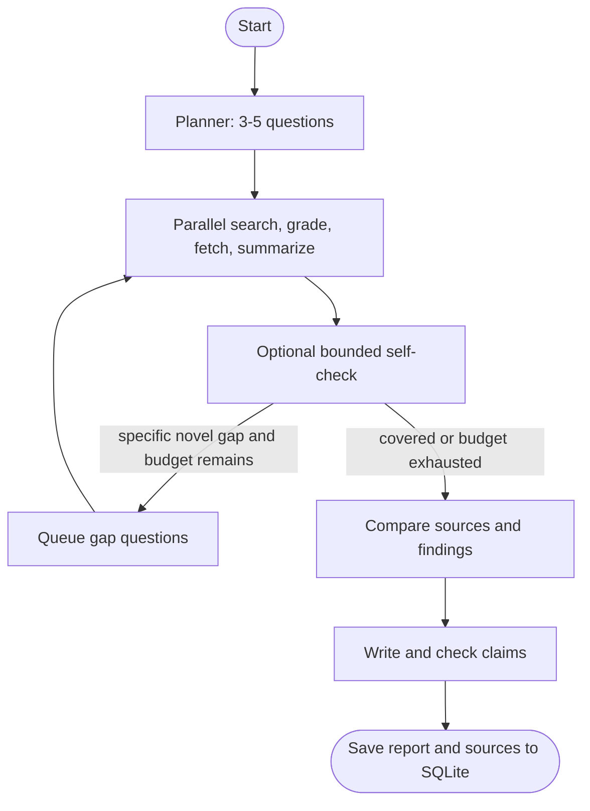

# AI Research Agent

A Streamlit research assistant that plans questions, searches the web, reads source pages, reflects on evidence gaps, compares sources, and writes a cited Markdown report. It uses LangGraph for workflow orchestration, Groq for language-model calls, DuckDuckGo by default (or Tavily when configured), `httpx` and Trafilatura for page reading, and SQLite for history.

## Requirements

- Python 3.11 or newer
- A free Groq API key

Get a key by creating an account at [Groq Console](https://console.groq.com/keys), then create an API key in the console. Keep the key private.

## Setup and run

From the project directory:

```powershell
py -3.11 -m venv .venv
.\.venv\Scripts\Activate.ps1
python -m pip install --upgrade pip
pip install -r requirements.txt
Copy-Item .env.example .env
```

Edit `.env` and set `GROQ_API_KEY` to your key. Then start the app:

```powershell
streamlit run app.py
```

Open the local URL printed by Streamlit (usually http://localhost:8501). On macOS/Linux, create/activate the environment with `python3.11 -m venv .venv` and `source .venv/bin/activate`; copy `.env.example` to `.env` with `cp`.

The default report model is `openai/gpt-oss-120b`; select a model in the sidebar. Small-model helper tasks and the bounded rate-limit fallback use `openai/gpt-oss-20b`. The retired Llama IDs from earlier versions are mapped to these supported replacements. Set `TAVILY_API_KEY` in `.env` to use Tavily instead of the no-key DuckDuckGo provider. Research history is stored in `research_history.sqlite3` in the project directory.

Choose **Quick** for three questions, one query and two pages per question, no reflection round, and a 90-second budget. Choose **Deep** for four or five questions, up to two queries and three pages per question, with up to two self-check rounds and a six-minute budget. Searches, relevance grading, page reads, and summaries run concurrently across questions. The app shows elapsed time and a per-node timing table; detailed JSONL telemetry is appended to `logs/research_agent.jsonl`.

Groq retired `llama-3.1-8b-instant` for standard accounts in August 2026; this project uses its recommended `openai/gpt-oss-20b` replacement for helper calls. See the [Groq model deprecation notes](https://console.groq.com/docs/deprecations).

## Architecture



## How it avoids hallucination

The planner keeps report instructions out of search queries. Result grading uses titles and snippets, and fetched passages are trimmed for question relevance. Reflection searches require a specific unresolved gap. The writer checks finding support in the same call used to produce the report; clickable sources are collected at the end. Source quality and coverage still depend on the search results and accessible page text.

## Project layout

- `app.py`: Streamlit interface and live graph progress.
- `agent/graph.py`: typed LangGraph state and bounded routing.
- `agent/nodes.py`: planning, concurrent search and reading, reflection, comparison, and report writing.
- `agent/prompts.py`: centralized prompt text.
- `agent/tools.py`: normalized web search and robust page extraction.
- `agent/llm.py`: Groq setup, rate-limit fallback, JSON parsing.
- `agent/db.py`: SQLite research history.
- `agent/telemetry.py`: per-run timing, budgets, counters, and JSONL logging.
- `tests/`: tests for search normalization, graph routing, planner cleanup, relevance filtering, duplicate-query rejection, and claim verification.

## Extensions

- Add a domain allowlist, source-quality scoring, and publication-date extraction.
- Add provider adapters for additional search engines or local models.
- Add report export to PDF/HTML and richer source metadata.
- Add caching and per-user history separation for deployed instances.

Run the tests with `python -m pytest` after installing the dependencies.
